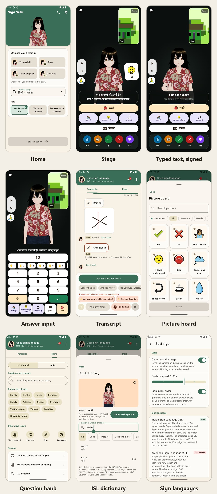

# Sign Setu

An offline Android app that helps a police officer communicate with a person who cannot communicate in words: deaf, non-verbal, traumatised or speaking another language. A 3D character signs and gestures, pictures and captions carry the question, typed text is played in draft Indian Sign Language order, and signed answers are read on the phone inside explicit sign windows. The app is a communication aid, not an interpreter, and never records statements.

- Version 0.8.1 (version code 17). Android 10 (API 29) and later, 64-bit; Kotlin and Jetpack Compose; one `app` module.
- Works fully offline. The published build carries the department gateway: turning the online assistant on asks the officer to continue with the gateway, which enrols with a one-time department code, or to set a custom API endpoint (any OpenAI- or Anthropic-compatible service) in the same dialog. Either is used only while online and once the officer switches the online assistant on; otherwise nothing connects. No assistant key is compiled into an APK. No RECORD_AUDIO permission, and no location or scanning permission in the `standard` flavor; every build fails if a forbidden permission reaches the merged manifest.
- Optional on-device assistant: Gemma 3 1B Q4_K_M GGUF (about 806 MB, [Hugging Face](https://huggingface.co/ggml-org/gemma-3-1b-it-GGUF/resolve/main/gemma-3-1b-it-Q4_K_M.gguf)), handed out by the department as a file; Settings imports it and keeps it only if its SHA-256 is on the allow-list. The app never downloads it.
- Sessions live in an encrypted SQLCipher database under a Keystore key that works only while the phone is unlocked. A finished session is saved under a name the officer types; every session is deleted 24 hours after its last activity by default, by an hourly background job even if the app is never opened; the officer can pick 4 to 72 hours or keep sessions until deleted.

## Screenshots

Every screen is in [docs/12-screens.md](docs/12-screens.md).

## What it does

- **Stage for the person:** a 3D character signs questions in draft ISL order (recorded ISL signers for most words, recorded sentence clips where a typed sentence matches one), with pictures, captions in 17 languages and recorded speech. Answers come by tap, picture, writing, drawing, nod or shake, finger count, or signing to the camera. Water and food can be asked for at any moment and are logged as requests, not answers.
- **Sign reading:** MediaPipe Holistic landmarks feed small on-device readers. ISL: 314 words, single letters and digits, and spelled names; ASL (experimental): 250 words and fingerspelling. Raised hands open a sign window, which closes when the hands rest for 2 s, nothing is signed for 3 s, or 20 s pass. Guesses that answer the question on screen rank first. A reading goes to the officer only and is never an answer until the person picks its meaning from pictures. Accuracy: [tools/ml/EVAL.md](tools/ml/EVAL.md).
- **Officer side:** two-way transcription, a question bank including a full ISL lesson sheet in Hindi and English, phrases, show-back, an ISL and an ASL dictionary, and Manual or Auto conversation. Back leaves a session for the start screen without ending it; with a second screen connected it asks first, because leaving drops the link.
- **Second screen:** a paired phone shows the stage over bonded Bluetooth.
- **AI counsellor:** with the online assistant on, it can talk with a frightened victim or witness on the stage; each line waits 2 s on the officer's screen, where the officer can send it at once, replace it or take over. It is never offered for an accused person or anyone in custody.
- **Records:** finished sessions are listed on the start screen, can be opened again, and export to a password-protected PDF with a hash chain and a draft BSA s.63 certificate.
- **Settings:** interpreter contact, security (pin the app, block screenshots, fingerprint), stage camera and signing speed, ISL word order, the two sign languages and their accuracy, the assistants, retention, and Appearance (device default, light or dark, a pure-black dark mode, and ten colour themes).
- **Type-to-Sign practice** (Settings, Practice) plays any Hindi or English sentence outside a session, with nothing recorded.

## Links

| Resource | Link | Notes |
| --- | --- | --- |
| Android APKs | [Latest release](https://github.com/Yash-Awasthi/sign-setu/releases/latest) | Signed `sign-setu-<version>-arm64.apk` for phones and `sign-setu-<version>-universal.apk` (arm64 and x86_64) for tablets and emulators, with SHA-256 sums and an SBOM; both carry the department gateway |
| Department gateway | [signsetu-gateway.onrender.com](https://signsetu-gateway.onrender.com/healthz) | Go on Render, Neon PostgreSQL; the free tier sleeps, so the first call can take about 30 s |
| Reviewer portal | [signsetu-portal.pages.dev](https://signsetu-portal.pages.dev) | Every motion on the app's own character, for content sign-off; Cloudflare Pages |
| On-device model | [gemma-3-1b-it-Q4_K_M.gguf](https://huggingface.co/ggml-org/gemma-3-1b-it-GGUF/resolve/main/gemma-3-1b-it-Q4_K_M.gguf) | About 806 MB; Settings, On-device assistant |
| Documentation | [docs/README.md](docs/README.md) | Requirements, architecture, security, DPIA |

## Build and test

The build needs JDK 21, Android SDK 37, NDK `30.0.16248370` and CMake 4.1.1. Dependencies are pinned in `gradle/libs.versions.toml`, locked in `app/gradle.lockfile` and verified by `gradle/verification-metadata.xml`. Build from a checkout outside a OneDrive folder: Files On-Demand marks sources as reparse points, which Java reports as "not a regular file", and annotation processing then fails.

| Command | Result |
| --- | --- |
| `./gradlew assembleStandardDebug` | Debug APK |
| `./gradlew testStandardDebugUnitTest` | Unit tests (also `testNearbyDebugUnitTest`) |
| `./gradlew connectedStandardDebugAndroidTest` | Instrumented tests on an emulator or phone |
| `cd avatar && npm install && npx vp test` | Avatar module tests; `npx vp build` rebuilds `app/src/main/assets/avatar/avatar.js` |
| `cd portal && npm install && npx vp test` | Reviewer portal tests (needs `npm install` in `avatar/` first) |
| `cd gateway && go test ./...` | Department gateway tests |
| `python tools/content/build_content.py --manifest-only` | Rebuilds the content hash manifest; run after any content change |

`SignPipelineDeviceTest` runs real ISLRTC clips (`app/src/androidTest/assets/islrtc/`) through the camera pipeline. It must pass after any MediaPipe or protobuf update: MediaPipe 1.1.1 runs on `protobuf-javalite`, and the full runtime breaks the landmarker without failing a unit test. `LessonTest` and `LessonSigningAuditTest` pin the lesson sheet's wording and how each sentence is signed.

## Release

| Command | Output |
| --- | --- |
| `./gradlew assembleStandardRelease` | Universal APK, arm64-v8a and x86_64 |
| `./gradlew assembleStandardRelease -Pabi=arm64-v8a` | Phone APK |

Release builds use R8 with resource shrinking. `-PgatewayUrl=https://...` (or `gatewayUrl=` in `local.properties`) builds in the department gateway; `-PsecureScreen=true` turns Settings, Security, Block screenshots on by default. A green push to `master` makes CI sign both APKs with the release key from repository secrets and publish `v<versionName>`: a new version gets a new release, the same version has its APKs replaced. See [docs/README.md](docs/README.md), section 5.

## Repository

| Path | Contents |
| --- | --- |
| `app/` | The Android app (`app.signsetu`; application ID `in.signsetu`), flavors `standard` and `nearby` (Play services) |
| `app/src/main/assets/content/` | Content bundle: questions, cards, motions, clips, vocabulary, audio, models, hash manifest |
| `avatar/` | The 3D character (TypeScript, three.js, three-vrm): keyframe rig, retargeting onto the VRM model, clip playback; built into `app/src/main/assets/avatar/` |
| `gateway/` | Department gateway (Go, PostgreSQL): device enrolment, assistant and speech proxies, administrator device and audit views ([README](gateway/README.md)) |
| `portal/` | Reviewer portal for content sign-off (Vite+, React, TypeScript); not shipped ([README](portal/README.md)) |
| `tools/content/` | Content bundle, audio and sign builders and checks |
| `tools/isl/` | Retargeting recorded ISL and ASL signers onto the character ([README](tools/isl/README.md)) |
| `tools/ml/` | Sign reader training, export and evaluation ([README](tools/ml/README.md), [EVAL](tools/ml/EVAL.md)) |
| `tools/text2isl/` | Recorded sentence clips ([README](tools/text2isl/README.md)) |
| `tools/security/` | CycloneDX SBOM of the release APK (`sbom.py`, needs Syft) |
| `content/` | Source symbols for the picture cards |
| `render.yaml` | Render blueprint for the gateway |
| `docs/` | Requirements, architecture, security and data protection assessment ([index](docs/README.md)) |
